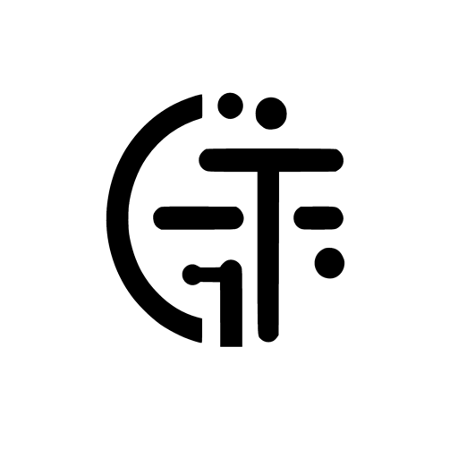
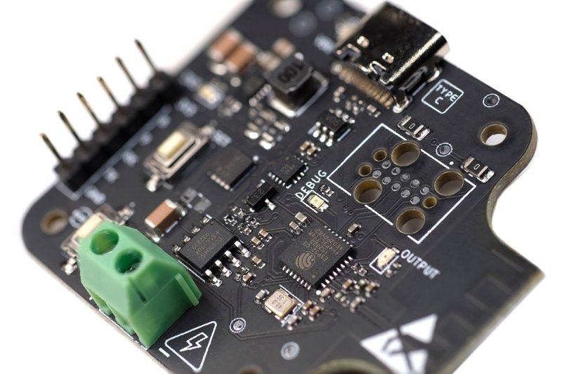
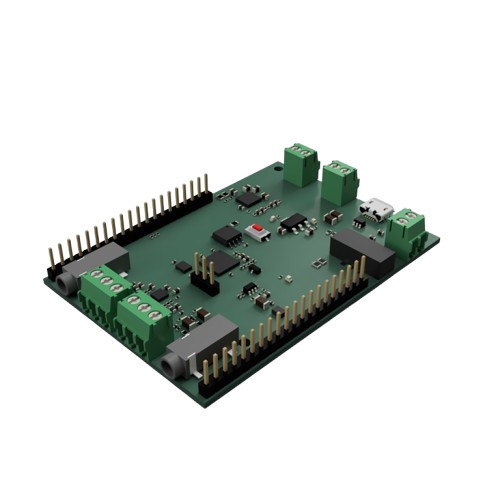

  <a href="https://elektroth.ing"><picture>
    <source media="(prefers-color-scheme: dark)" srcset="assets/elektrothing-logo-dark.png" />
    
  </picture></a>

# Jason Too

I build things at the edges of **software, AI, and hardware**.

I'm an engineer in Cambridge, UK, and the founder of [elektroThing](https://elektroth.ing). I like tools that make complex systems easier to understand, and small products that feel personal to use.

## What I'm making

- **[Patchly](https://patchly.cc)** is a shipped developer tool for production errors. It catches production crashes, explains the root cause in plain English, and opens a draft pull request with the fix.
- **[Trinkt](https://trinkt.co)** is a social app for sending procedurally generated art to close friends: a small way to say “thinking of you.”
- **[ollamacode](https://github.com/tooyipjee/ollamacode_cli)** explores local-first AI for coding. It uses Ollama and can work with files and commands without cloud API keys.

I'm especially interested in **AI agents and developer tools**, local-first software, and consumer products that make technology feel a little more human.

## From the workbench

Hardware is still part of how I think. **[Spark Analyzer](https://elektroth.ing/work#spark-analyzer)** is an open-source USB-C Power Delivery analyzer and programmable power supply, 596% funded on Crowd Supply; **[DS-Pi](https://elektroth.ing/work#ds-pi)** is an RP2040 audio DSP board for signal-processing experiments. elektroThing is also listed as a manufacturer on [Mouser](https://www.mouser.com/manufacturer/elektrothing/). There's more embedded and hardware work in the [elektroThing project archive](https://elektroth.ing/work).

  
  

## Let's make something together

Working on an agent, a developer tool, a local-first AI product, a thoughtful consumer app, or interesting hardware? **[Email me](mailto:contact@elektroth.ing)** about collaborating.

[Portfolio](https://elektroth.ing) · [GitHub](https://github.com/tooyipjee) · [LinkedIn](https://www.linkedin.com/in/jason-too/)
